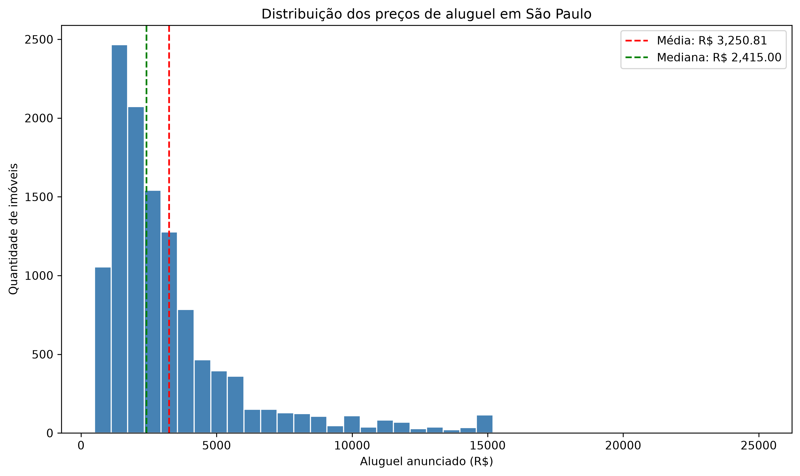
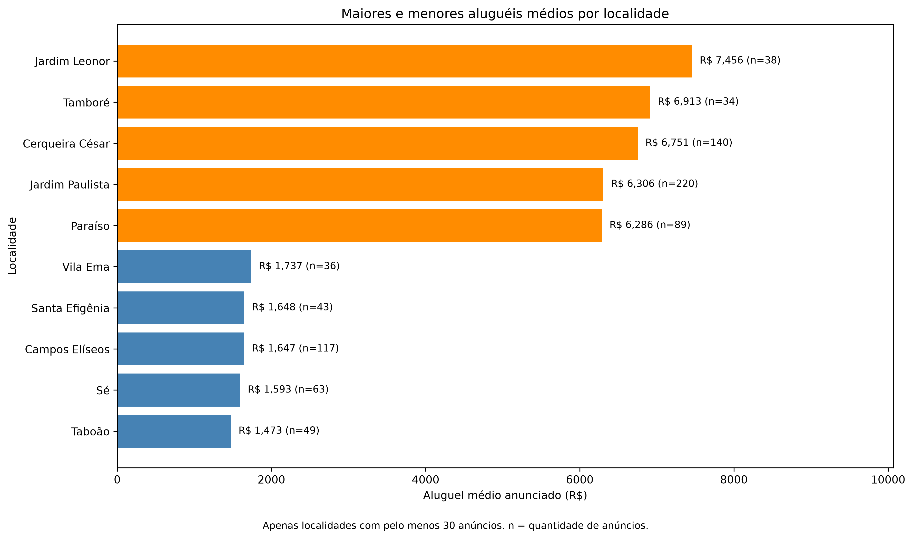
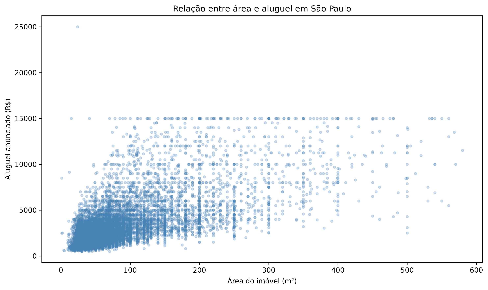
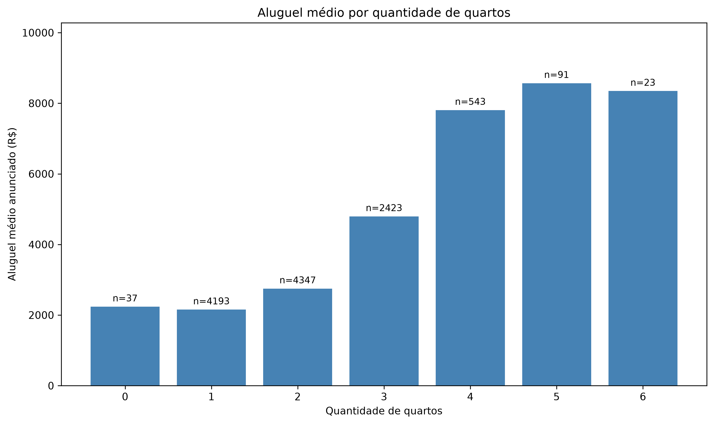
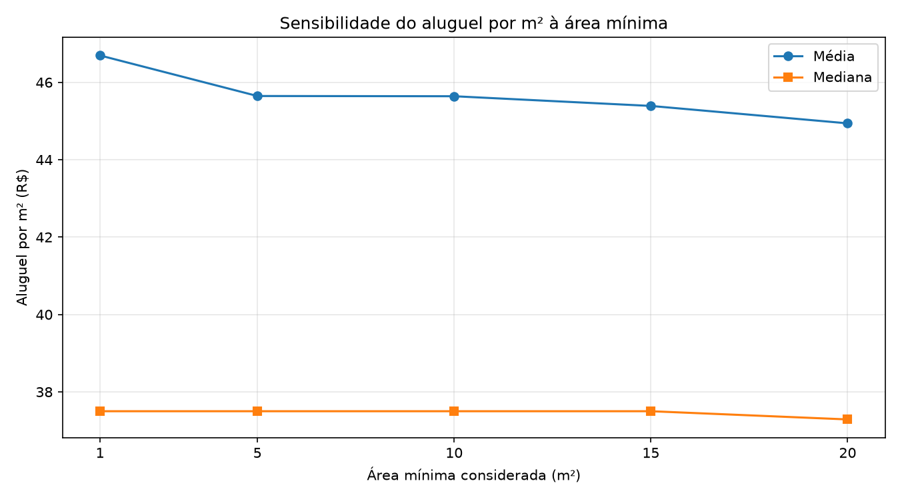
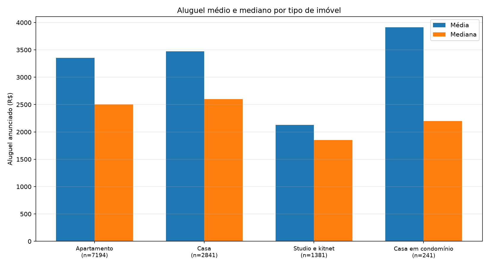

# Análise Exploratória dos Preços de Aluguel em São Paulo

**Desafio SYNAPTA 2026 — Etapa 2**

**Instituição:** UNINASSAU — Maceió/AL  
**Curso:** Ciência da Computação  
**Modalidade:** Análise exploratória de dados  
**Opção escolhida:** 1 — Preços de aluguel em São Paulo

## 1. Objetivo

Investigar como localização, área e quantidade de quartos se relacionam com os aluguéis anunciados nos imóveis presentes no dataset de São Paulo.

**Pergunta orientadora:** quais características parecem acompanhar os maiores e os menores preços de aluguel e o que os dados não permitem concluir?

## 2. Fonte dos dados

- **Dataset:** Sao Paulo Housing Prices
- **Fonte:** [Kaggle — Sao Paulo Housing Prices](https://www.kaggle.com/datasets/renatosn/sao-paulo-housing-prices)
- **Licença indicada no Kaggle:** CC0 — Public Domain
- **Tamanho da base analisada:** 11.657 registros e 8 colunas

O dataset original **não está incluído neste repositório**, por decisão de organização do projeto. Para reproduzir a análise, faça o download na fonte indicada e coloque o CSV na raiz do repositório com o nome `data.csv`.

### Variáveis utilizadas

| Coluna | Descrição |
|---|---|
| `address` | Endereço informado no anúncio |
| `district` | Localidade informada no anúncio |
| `area` | Área do imóvel (m²) |
| `bedrooms` | Quantidade de quartos |
| `garage` | Quantidade de vagas de garagem |
| `type` | Tipo de imóvel |
| `rent` | Aluguel anunciado (R$) |
| `total` | Custo total indicado no anúncio (R$) |

As descrições refletem a interpretação utilizada nesta análise; a base não foi tratada como um cadastro de contratos efetivamente negociados.

## 3. Tecnologias utilizadas

- Python 3.12
- Pandas 3.1.0
- Matplotlib 3.11.2
- Visual Studio Code
- Git e GitHub

## 4. Metodologia

1. Leitura e inspeção do dataset.
2. Verificação de valores ausentes, duplicações exatas e inconsistências.
3. Preservação dos registros originais: dois anúncios com área igual a zero foram desconsiderados **somente nas análises que dependem de área válida**.
4. Investigação de um anúncio atípico, com aluguel de R$ 25.000 para 24 m², sem exclusão automática.
5. Cálculo de média, mediana e distribuição dos aluguéis.
6. Comparação dos aluguéis médios entre localidades com **pelo menos 30 anúncios**; teste adicional dos limites de 20 e 50 anúncios.
7. Análise da associação entre área e aluguel e comparação dos valores por quantidade de quartos.
8. Construção e interpretação de quatro gráficos.

O limite de 30 anúncios foi escolhido como critério **exploratório**, não como garantia de representatividade estatística.

## 5. Resultados e visualizações

### 5.1 Distribuição dos aluguéis

- **Média:** R$ 3.250,81
- **Mediana:** R$ 2.415,00

A média superior à mediana, junto ao histograma, indica assimetria à direita na distribuição dos aluguéis anunciados.



### 5.2 Comparação entre localidades

Entre as localidades com pelo menos 30 anúncios, **Jardim Leonor** apresentou o maior aluguel médio (R$ 7.455,74; 38 anúncios), enquanto **Taboão** apresentou o menor (R$ 1.473,14; 49 anúncios).



Os resultados dependem do critério de inclusão. Na análise de sensibilidade:

| Limite mínimo | Localidades analisadas | Cobertura dos anúncios | Localidade com maior média |
|---|---:|---:|---|
| 20 anúncios | 131 | 61,10% | Alphaville |
| 30 anúncios | 78 | 50,36% | Jardim Leonor |
| 50 anúncios | 38 | 37,47% | Cerqueira César |

### 5.3 Relação entre área e aluguel

Considerando somente os **11.655 imóveis com área positiva**, a correlação de Pearson entre área e aluguel foi **0,667**, indicando associação linear positiva na amostra, sem implicar causalidade.



### 5.4 Quantidade de quartos e aluguel

Há uma tendência geral de aluguéis médios mais altos em imóveis com mais quartos, mas a relação não é perfeitamente crescente e o número de anúncios difere bastante entre grupos.



### 5.5 Investigação de valor atípico

Foi identificado um studio no Planalto Paulista, com **24 m²** e aluguel anunciado de **R$ 25.000**. A exclusão **experimental** desse anúncio reduziu a média geral em aproximadamente **0,057%** e a média dos studios em aproximadamente **0,78%**. O registro foi mantido na análise principal porque não havia evidência suficiente para comprovar erro.

### 5.6 Aluguel por metro quadrado e sensibilidade à área

A análise dos **11.655 imóveis com área positiva** apresentou aluguel médio de **R$ 46,69/m²** e mediano de **R$ 37,50/m²**.

Foram identificados quatro registros com áreas inferiores a 5 m², incluindo uma casa em condomínio com quatro quartos, três vagas de garagem e área declarada de apenas 1 m², representando uma possível inconsistência cadastral.

A exclusão experimental desses quatro registros reduziu a média para **R$ 45,65/m²**, enquanto a mediana permaneceu em R$ 37,50/m².

Na análise de sensibilidade, ao considerar apenas imóveis com área de pelo menos 20 m², a média passou para **R$ 44,94/m²** e a mediana para **R$ 37,29/m²**.

A comparação entre os rankings demonstrou que os imóveis com maiores aluguéis totais não são necessariamente aqueles com os maiores valores por metro quadrado.

**Decisão metodológica:** os registros com áreas positivas foram preservados na análise principal. Os limites mínimos de área foram utilizados exclusivamente para avaliar a sensibilidade dos indicadores, sem excluir definitivamente observações suspeitas.

**Conclusão:** a mediana apresentou maior estabilidade diante dos valores extremos investigados, reforçando a importância da avaliação de qualidade dos dados.



### 5.7 Comparação dos aluguéis por tipo de imóvel

O dataset apresenta quatro categorias de imóveis: apartamentos (7.194 anúncios), casas (2.841), studios e kitnets (1.381) e casas em condomínio (241).

A comparação mostrou que as **casas em condomínio apresentam o maior aluguel médio (R$ 3.912,55)**, mas sua mediana é de apenas R$ 2.200,00. As casas, por sua vez, apresentam a maior mediana entre as categorias, de R$ 2.600,00.

Os studios e kitnets apresentaram os menores valores de média (R$ 2.127,83) e mediana (R$ 1.850,00).

A investigação das casas em condomínio identificou nove anúncios com aluguel de R$ 15.000,00. A exclusão experimental de cinco desses registros reduziu a média da categoria em aproximadamente **6%**, enquanto a mediana permaneceu inalterada.

Esses resultados demonstram a importância de analisar média e mediana conjuntamente, especialmente quando existem anúncios com valores elevados.

**Limitação:** as categorias diferem em quantidade de anúncios, área e outras características. As diferenças observadas não devem ser interpretadas como efeitos causais do tipo de imóvel.



## 6. Cinco conclusões principais

1. **Os aluguéis anunciados têm distribuição assimétrica à direita:** a média de R$ 3.250,81 supera a mediana de R$ 2.415,00.
2. **Existem diferenças expressivas entre localidades:** no recorte com pelo menos 30 anúncios, Jardim Leonor apresentou média de R$ 7.455,74 e Taboão de R$ 1.473,14.
3. **Área e aluguel apresentam associação positiva:** correlação de Pearson de 0,667 na amostra com área positiva.
4. **A quantidade de quartos acompanha uma tendência geral de aumento do aluguel**, embora haja exceções e grupos com poucos anúncios.
5. **A influência de um valor extremo depende do grupo analisado:** a retirada experimental do maior aluguel teve impacto proporcional mais alto entre studios do que no conjunto completo.

A discussão detalhada, a análise de sensibilidade e a resposta completa à pergunta orientadora estão em [CONCLUSOES.md](CONCLUSOES.md).

## 7. Limitações

- Os valores são de **anúncios**, não necessariamente de contratos efetivamente fechados.
- O dataset não representa obrigatoriamente todo o mercado imobiliário de São Paulo.
- As associações observadas **não comprovam causalidade**.
- As localidades têm quantidades diferentes de registros, e a classificação muda com o limite mínimo adotado.
- Características como conservação e localização não foram controladas simultaneamente nas comparações.
- A veracidade do anúncio de R$ 25.000 não foi confirmada externamente.
- O arquivo CSV foi obtido anteriormente; o download diretamente do Kaggle não foi novamente testado durante a auditoria de reprodução.

## 8. Como executar o projeto

### Pré-requisitos

Python 3.12 e acesso ao dataset no Kaggle. Git é opcional se o repositório for baixado como arquivo ZIP.

### Preparação

1. Clone ou baixe este repositório.
2. Abra a pasta do projeto no terminal.
3. Instale as dependências:

   ```bash
   python -m pip install -r requirements.txt
   ```

4. Baixe o dataset [Sao Paulo Housing Prices](https://www.kaggle.com/datasets/renatosn/sao-paulo-housing-prices) no Kaggle.
5. Extraia o arquivo CSV e coloque-o na **raiz do projeto**, com o nome exato `data.csv`.
6. Execute:

   ```bash
   python analise.py
   ```

O programa exibe estatísticas no terminal e salva quatro imagens na pasta `graficos/`. Dependendo do ambiente, as janelas dos gráficos podem precisar ser fechadas para a execução continuar.

### Verificação de reprodutibilidade realizada

O projeto foi clonado do GitHub para uma pasta separada. Em um novo ambiente virtual Python, foram instaladas as dependências do `requirements.txt`, copiado o CSV local já utilizado e executado o `analise.py` até o final, sem exceções. Os indicadores e os quatro gráficos foram reproduzidos.

Esse teste **não incluiu um novo download direto da página do Kaggle**.

## 9. Declaração de uso de inteligência artificial generativa

Foi utilizado **ChatGPT (OpenAI)** como apoio educacional e técnico para explicar conceitos estatísticos, orientar a elaboração e revisão de código Python com Pandas e Matplotlib, discutir tratamentos de dados e valores atípicos, sugerir gráficos, auxiliar na documentação e orientar procedimentos com Git e GitHub.

**Verificações realizadas pelo candidato:** execução dos códigos em Python 3.12, conferência das saídas e dos indicadores estatísticos, inspeção dos gráficos, investigação de valores atípicos e teste completo da análise a partir de uma cópia clonada do repositório com ambiente virtual independente.

As interpretações são apresentadas com as limitações identificadas. A utilização da ferramenta não implica que ela tenha verificado externamente a veracidade dos anúncios. A obtenção direta do dataset pelo link do Kaggle continua sem um novo teste de download nesta auditoria.

## 10. Estado do projeto

Análise exploratória executada e documentada; reprodutibilidade testada com cópia local do dataset. Projeto em revisão para submissão à Etapa 2 do processo seletivo SYNAPTA 2026.
